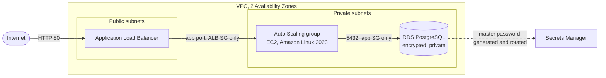
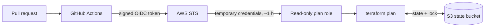

# platform-starter-kit

Reusable Terraform modules for a production-style, three-tier AWS platform (network, load-balanced compute and a PostgreSQL database), delivered through a CI (Continuous Integration) pipeline with no long-lived credentials, security scanning on every pull request, and remote state with locking.

[](https://github.com/RonanCraig/platform-starter-kit/actions/workflows/terraform.yml)

## Architecture



Each tier only accepts traffic from the security group in front of it. Nothing in the private subnets has a public IP, and the database password never appears in code or Terraform state.



## What this demonstrates

- **Modular IaC (Infrastructure as Code):** small, single-purpose modules (`vpc`, `service`, `database`) composed in root modules under `examples/`, with typed and documented inputs and outputs.
- **Keyless CI:** GitHub Actions authenticates to AWS through OIDC (OpenID Connect) federation. The trust policy is pinned to this repository's immutable subject claim, and the role is read-only.
- **Gated changes:** `main` is protected. Every change needs a pull request with four passing checks: `fmt`, `security` (Checkov) and a `plan` for each example.
- **Security scanning with triage:** every Checkov finding is either fixed or skipped with a written justification next to the code. There are no blanket suppressions.
- **Remote state:** a versioned, encrypted, private S3 bucket with S3-native locking and one state file per root module, created by a separate `bootstrap/` configuration.
- **Secure defaults:** IMDSv2 required, encryption at rest, the VPC's default security group locked down, database deletion protection on by default, and secrets managed by AWS rather than by Terraform.
- **Cost awareness:** the NAT gateway is optional, the defaults are small instance classes, Multi-AZ is opt-in, and old state versions expire.

## Modules

| Module | What it builds |
|---|---|
| [`vpc`](modules/vpc) | VPC (Virtual Private Cloud) across 2–3 Availability Zones with public and private subnets, an internet gateway, route tables, a locked-down default security group and an optional NAT (Network Address Translation) gateway |
| [`service`](modules/service) | Internet-facing ALB (Application Load Balancer) plus an Auto Scaling group of EC2 instances in private subnets, with ELB health checks and CPU target-tracking scaling |
| [`database`](modules/database) | RDS (Relational Database Service) PostgreSQL in private subnets: encrypted, IAM authentication, Performance Insights, logs exported to CloudWatch, optional Multi-AZ, with the master password generated and rotated in Secrets Manager |

Each module's README lists its inputs and outputs.

## Repository layout

```
bootstrap/          # one-off root: S3 state bucket + GitHub OIDC provider and CI plan role (local state)
modules/
  vpc/
  service/
  database/
examples/
  basic/            # vpc only
  web-service/      # vpc -> service -> database: the full three-tier stack
.github/workflows/
  terraform.yml     # fmt, Checkov, plan per example on every pull request
```

## Getting started

### 1. Bootstrap (once per AWS account)

`bootstrap/` creates the S3 state bucket and the GitHub OIDC trust. It keeps its own state locally, because the bucket can't store the state of the configuration that creates it.

```bash
cd bootstrap
terraform init
terraform apply
terraform output state_bucket_name
```

If you fork this repo, set `github_repo` to your repository's OIDC subject prefix:

```bash
gh api repos/OWNER/REPO/actions/oidc/customization/sub
```

### 2. Point the examples at your bucket

Each example's `versions.tf` has a `backend "s3"` block. Replace `bucket` with your bucket name. Backend blocks can't use variables, because they're read before anything else is evaluated.

### 3. Run an example

```bash
cd examples/web-service
terraform init
terraform apply
curl "http://$(terraform output -raw alb_dns_name)"   # allow a few minutes for health checks
terraform destroy
```

`examples/web-service` creates billable resources (the ALB, EC2 instances and RDS are billed hourly). Destroy it when you've finished.

## CI pipeline

[`terraform.yml`](.github/workflows/terraform.yml) runs on every pull request to `main`:

| Job | What it does | AWS access |
|---|---|---|
| `fmt` | `terraform fmt -check -recursive` | none |
| `security` | Checkov scan of all Terraform (pinned version, run with `pipx`, no third-party action) | none |
| `plan (examples/basic)` / `plan (examples/web-service)` | `init`, `validate`, `plan`, as a matrix job per root | read-only role via OIDC |

The plan role has `ReadOnlyAccess`, plus read access to state and write access only to `*.tflock` objects, so CI can lock state but never overwrite it.

## Security decisions

Checkov runs on every pull request. Findings that don't apply to a demo environment are skipped **inline, with the reason**, for example:

```hcl
# checkov:skip=CKV_AWS_2:No domain or ACM certificate in this demo; HTTPS is a documented follow-up
```

Search the repo for `checkov:skip` to see every accepted risk and why it was accepted.

## Requirements

- Terraform >= 1.10 (CI uses 1.17.2)
- AWS provider `~> 6.0`, pinned in each root module
- AWS credentials from the standard credential provider chain (e.g. `aws login`); no access keys in code

## Roadmap

- HTTPS on the ALB (Route 53 domain + ACM certificate)
- Apply job using a separate write role, trusted only for a protected `production` environment with manual approval
- Plan output posted as a pull request comment
- Optional VPC flow logs
